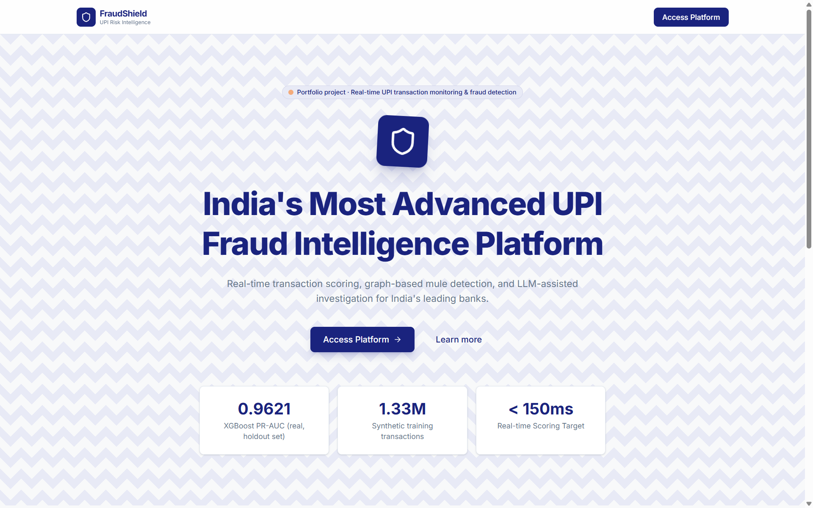
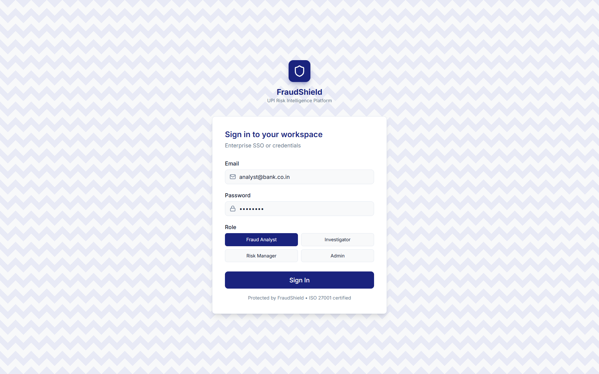
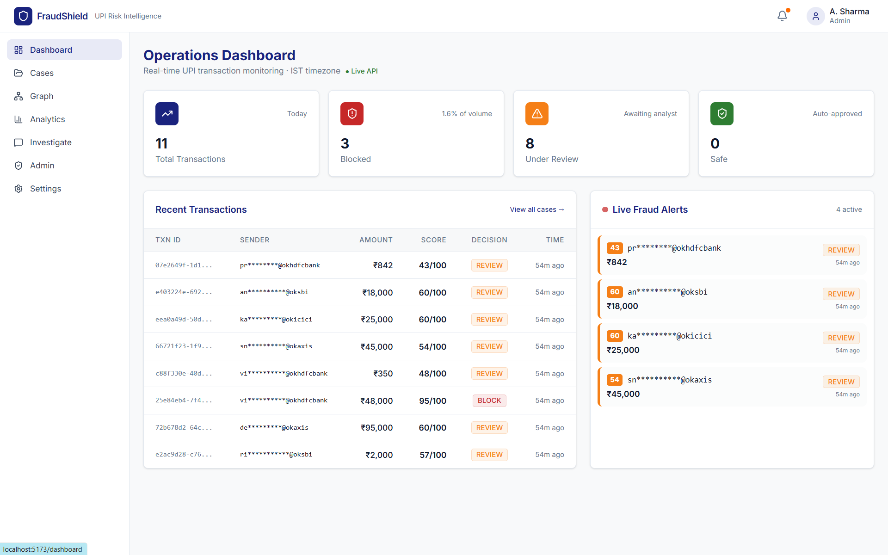
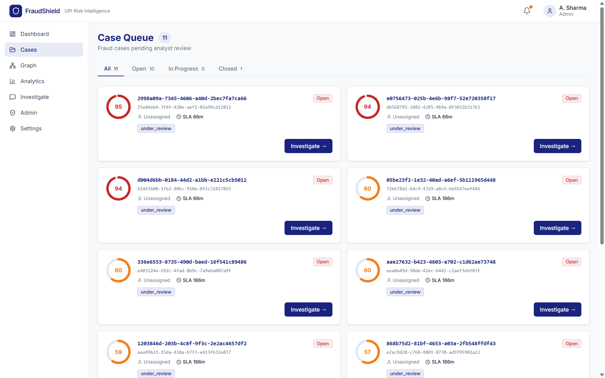
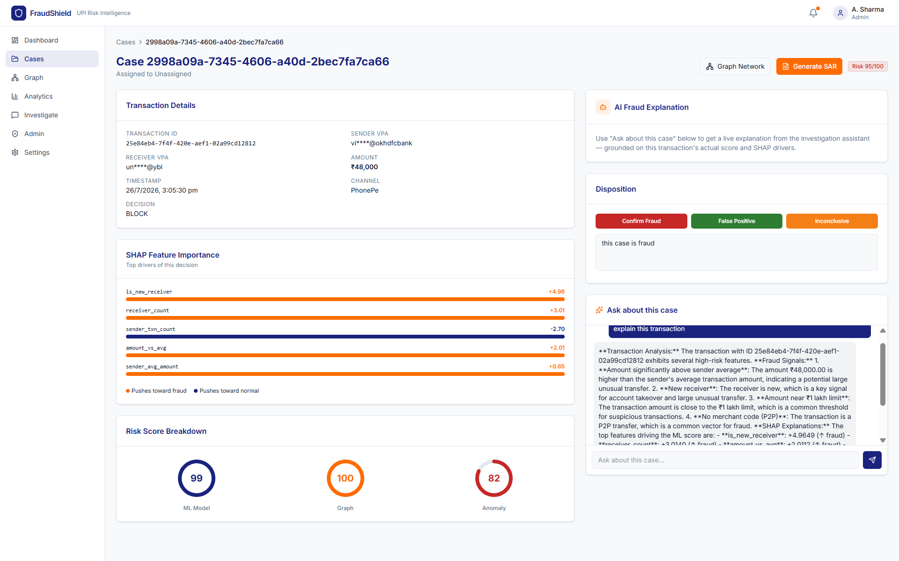
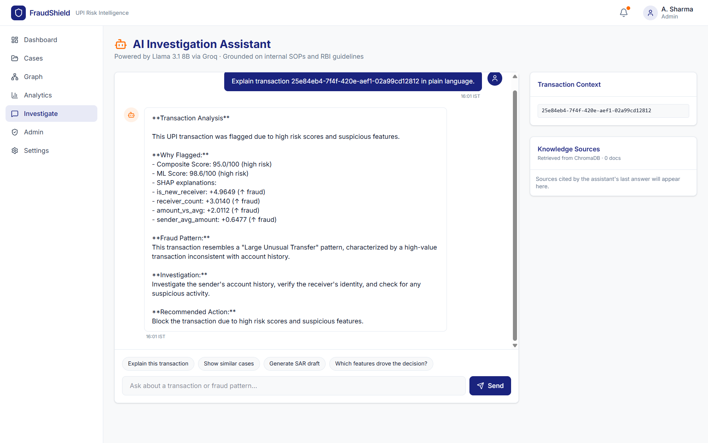
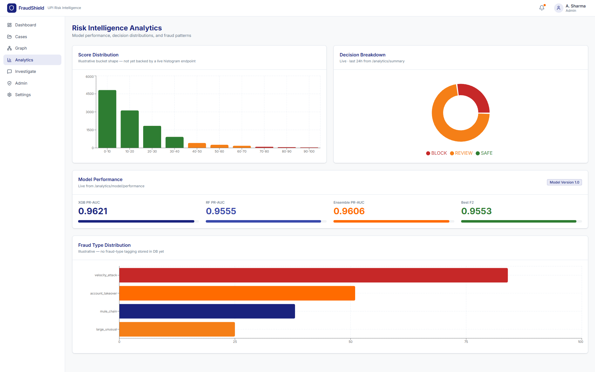
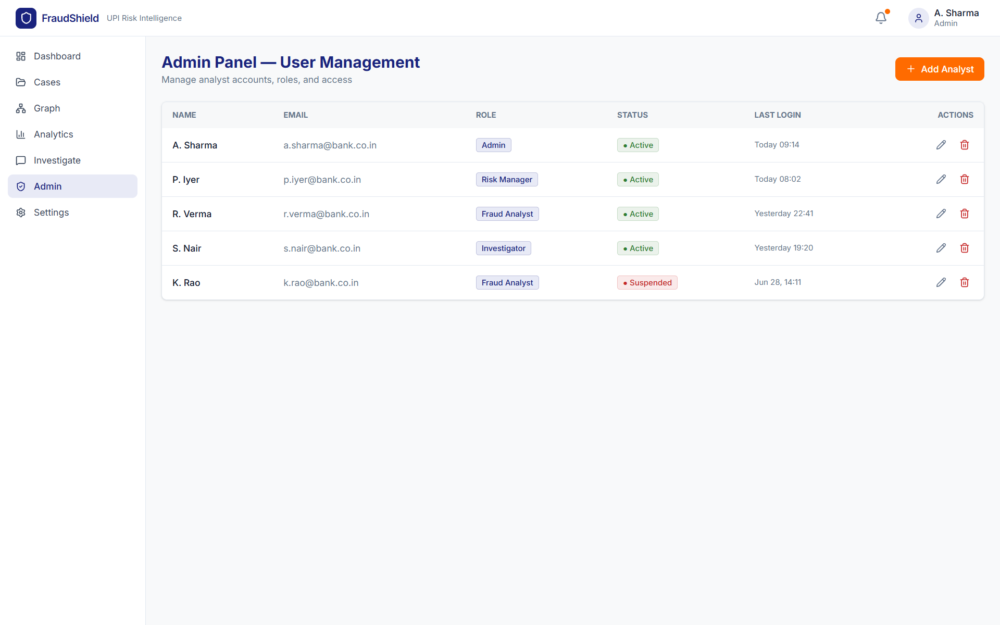
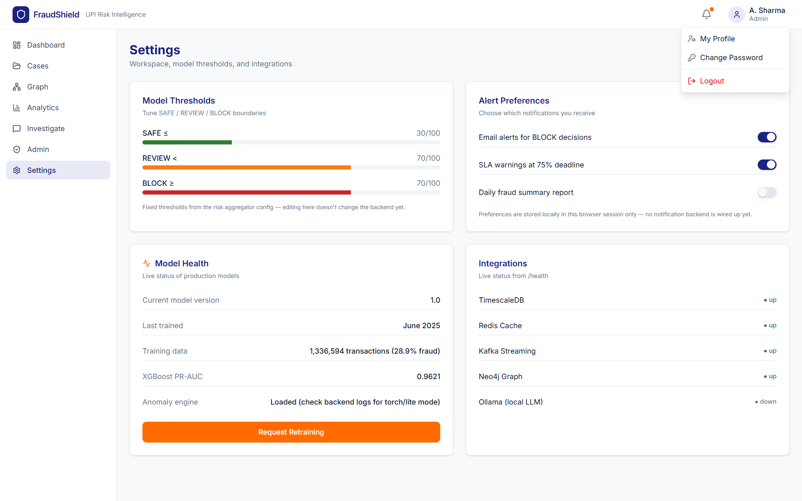

# RAKSHAK: UPI Fraud Detection Platform

A reference implementation for UPI transaction scoring, case triage, graph analysis, and analyst investigation workflows.

[Quick Start](#-quick-start) • [Architecture](#-architecture) • [API Reference](#-api-reference) • [Tech Stack](#-tech-stack)

[](https://python.org)
[](https://fastapi.tiangolo.com)
[](https://xgboost.readthedocs.io)
[](https://pytorch.org)
[](LICENSE)
[](https://groq.com)
[](https://react.dev)

---

## 📌 About the Project

**RAKSHAK** is an enterprise-grade payment fraud detection and risk intelligence architecture. It combines transaction scoring, case triage, graph analysis, and investigation tools.

### Key Capabilities
- **Risk scoring**: Combines tabular model, graph, and anomaly signals when the required services and model artifacts are available.
- **Feature attribution**: Returns SHAP feature contributions when the XGBoost model artifact is available.
- **Investigation support**: Retrieves documents from ChromaDB and can produce explanations and SAR drafts for analyst review. Drafts are not compliance determinations.

---

## 💡 Why This Project?

This project demonstrates components commonly used in transaction-risk workflows:

- **Signal aggregation**: Combines machine-learning, graph, and anomaly scores into a decision and review deadline.
- **Identifier masking**: Applies local pattern-based masking to selected identifiers before sending investigation prompts to the configured LLM provider.
- **Service boundaries**: Uses PostgreSQL/TimescaleDB, Neo4j, Redis, Kafka, and ChromaDB as separate infrastructure components.

---

## 🚀 Demo

### Features Demonstrated

- Modern Landing Page
- Demo role selection (no authentication provider configured)
- Fraud Monitoring Dashboard (demo)
- Fraud Case Management
- SHAP Explainable AI
- AI Investigation Assistant (LLM)
- Analytics Dashboard
- Graph-Based Fraud Investigation
- Admin View (demo)
- System Settings

---

## 🏗️ Architecture

```
┌─────────────────────────────────────────────────────────────────┐
│                      FraudShield Platform                       │
├──────────────────┬──────────────────┬───────────────────────────┤
│   Layer 1        │   Layer 2        │   Layer 3                 │
│   ML Engine      │   Graph Engine   │   Anomaly Engine          │
│                  │  (Neo4j Cypher)  │                           │
│  XGBoost*        │  Fraud Rings     │  Isolation Forest*        │
│  Random Forest*  │  Mule Heuristics │  Autoencoder*             │
│  Model outputs*  │  Network Risk    │  Feature signals          │
│  SHAP values*    │  Path searches   │                            │
├──────────────────┴──────────────────┴───────────────────────────┤
│   Layer 4 — Risk Aggregator                                     │
│   ML (40%) + Graph (35%) + Anomaly (25%) → Score 0-100         │
│   Decision: SAFE / REVIEW / BLOCK + SLA timer                  │
├─────────────────────────────────────────────────────────────────┤
│   Layer 5 — Optional Investigation Assistant                    │
│   Groq (Llama 3.1 8B) + Direct ChromaDB Client RAG              │
│   Explanations and SAR drafts for analyst review                  │
│   Custom regex PII masking before any LLM calls                 │
├─────────────────────────────────────────────────────────────────┤
│   Layer 6 — FastAPI Backend (:8000)                            │
│   23 endpoints (21 API routes + 2 system routes)                │
│   Kafka streaming (producer) · Redis cache · TimescaleDB        │
├─────────────────────────────────────────────────────────────────┤
│   Layer 7 — React Dashboard (:5173)                            │
│   Demo role navigation (not authorization)                       │
│   Fraud network view · Feature attribution · Investigation chat  │
└─────────────────────────────────────────────────────────────────┘
```
\* Model-based scoring requires trained files that are not included in this repository.

---

## 📸 Application Screenshots

<table width="100%">
  <tr>
    <td width="50%" align="center">
      <b>Landing Page</b><br/>
      <i>Landing Page – Modern entry point for FraudShield.</i><br/>
      
    </td>
    <td width="50%" align="center">
      <b>Workspace Login</b><br/>
      <i>Login – Demo role selection; no authentication provider is configured.</i><br/>
      
    </td>
  </tr>
  <tr>
    <td width="50%" align="center">
      <b>Operations Dashboard</b><br/>
      <i>Dashboard – Live fraud monitoring dashboard.</i><br/>
      
    </td>
    <td width="50%" align="center">
      <b>Fraud Case Queue</b><br/>
      <i>Case Queue – Fraud investigation workspace.</i><br/>
      
    </td>
  </tr>
  <tr>
    <td width="50%" align="center">
      <b>Case Details</b><br/>
      <i>Case Details – SHAP-powered transaction analysis.</i><br/>
      
    </td>
    <td width="50%" align="center">
      <b>AI Investigation Assistant</b><br/>
      <i>AI Investigation – LLM-powered investigation assistant.</i><br/>
      
    </td>
  </tr>
  <tr>
    <td width="50%" align="center">
      <b>Analytics Dashboard</b><br/>
      <i>Analytics – Model performance dashboard.</i><br/>
      
    </td>
    <td width="50%" align="center">
      <b>Admin Panel</b><br/>
      <i>Admin Panel – User and role management.</i><br/>
      
    </td>
  </tr>
  <tr>
    <td width="50%" align="center" colspan="2">
      <b>Threshold & Model Settings</b><br/>
      <i>Settings – Platform configuration.</i><br/>
      
    </td>
  </tr>
</table>

---

## ✨ Features

### 🤖 Tri-Engine Fraud Scoring
- **Supervised ML**: XGBoost and Random Forest inference code is present. The trained estimators and scaler are excluded, so predictions and published metrics cannot be reproduced from this checkout.
- **Graph queries**: Neo4j endpoints provide account relationships, path searches, and heuristic mule candidates. GCN/GAT training is not part of the online scoring path.
- **Anomaly scoring**: Isolation Forest and autoencoder inference code is present, but their trained artifacts are not included.

### 🔍 Conversational Investigation (RAG)
- **ChromaDB retrieval**: Searches documents already loaded into the configured ChromaDB collection.
- **Draft generation**: The optional Groq-hosted Llama 3.1 client can create explanations and SAR drafts; an analyst must verify all output before use.
- **Identifier masking**: A local regex-based masker handles selected VPA, IP, phone, and device patterns; it is not a general-purpose data-loss-prevention system.

### 📊 Event Pipeline & Caching
- **Redis cache**: Supports duplicate transaction ID checks over a five-minute window, blacklist lookups, and hourly sender counters when Redis is available.
- **Kafka streaming**: The API includes a producer for scored transactions and alerts; the Kafka service and topics must be available.

---

## 🛠️ Tech Stack

| Component | Technology | Role / Status |
|-----------|-----------|------------------|
| **API Backend** | FastAPI + Uvicorn | Routes are implemented; authentication and authorization are not configured |
| **Relational DB** | TimescaleDB (PostgreSQL) | Schema and client are present; service must be running |
| **Graph DB** | Neo4j Community | Cypher client and query routes are present; service must be running |
| **Key-Value Store** | Redis 7 | Optional deduplication, blacklist, and velocity integration |
| **Event Streaming** | Apache Kafka | Producer code is present; topics must be created |
| **Stream Compute** | Apache Flink | Container is configured; no processing job is included |
| **Supervised ML** | XGBoost + Random Forest | Inference code is present; trained model files are excluded |
| **Graph ML** | PyTorch Geometric | Offline assets only; GNN inference is not connected to API scoring |
| **Anomaly ML** | Isolation Forest + PyTorch | Inference code is present; trained model files are excluded |
| **LLM Client** | Groq (Llama 3.1 8B) | Optional; requires `GROQ_API_KEY` |
| **Local LLM** | Ollama | Optional container; the investigation client currently uses Groq |
| **Vector Database** | ChromaDB | Client integration is present; the collection must be populated |
| **Explainability** | SHAP | XGBoost explanation code requires the trained model artifact |
| **Experiment Tracking** | MLflow | Container is configured; model retraining is not implemented |
| **Monitoring** | Prometheus + Grafana | Docker configuration is present |
| **Frontend UI** | React 19 + Vite | TypeScript SPA with demo-only client-side roles |
| **Router** | TanStack Router | Type-safe client routing |
| **Data Viz** | Recharts + D3.js | Dashboard and graph visualizations |

---

## 🚀 Quick Start

### 1. Clone the repository
```bash
git clone https://github.com/Sumeet2005/FraudShield.git
cd FraudShield
```

### 2. Configure Environment
```bash
cp .env.example .env
# Replace the change-me values before starting services.
```
On Windows PowerShell, use:
```powershell
Copy-Item .env.example .env
```
```env
POSTGRES_DB=frauddb
POSTGRES_USER=frauduser
POSTGRES_PASSWORD=your_password
NEO4J_USER=neo4j
NEO4J_PASSWORD=your_password
GROQ_API_KEY=                         # Optional; required for Groq investigations
SECRET_KEY=replace_with_a_random_secret
DEBUG=false
GF_SECURITY_ADMIN_PASSWORD=your_grafana_password
CORS_ORIGINS=http://localhost:5173,http://127.0.0.1:5173
```

### 3. Start Infrastructure
```bash
# Pull and start Docker services (TimescaleDB, Neo4j, Redis, Kafka, ChromaDB)
docker compose up -d

# Verify containers are running
docker compose ps
```
*Note: For hosts with 8GB RAM, start only the core services:*
`docker start fraud_timescaledb fraud_redis fraud_chromadb fraud_kafka fraud_zookeeper`

### 4. Initialize Databases
```bash
py -3.11 -m venv .venv311
.\.venv311\Scripts\Activate.ps1   # Windows PowerShell
# source .venv311/bin/activate     # macOS / Linux

python -m pip install -r backend/requirements.txt
python backend/database/init_db.py
python backend/database/init_neo4j.py
```

### 5. Create Kafka Topics
```bash
docker exec fraud_kafka kafka-topics --create --bootstrap-server localhost:9092 --topic upi.transactions --partitions 8 --replication-factor 1
docker exec fraud_kafka kafka-topics --create --bootstrap-server localhost:9092 --topic upi.fraud-alerts --partitions 4 --replication-factor 1
docker exec fraud_kafka kafka-topics --create --bootstrap-server localhost:9092 --topic upi.dlq --partitions 2 --replication-factor 1
```

### 6. Start Services
```bash
# Start backend API (Swagger UI will be at http://localhost:8000/docs)
python backend/main.py

# Start React dashboard (will launch at http://localhost:5173)
cd frontend
npm install
npm run dev
```

### Local demo limitations
- Login only selects a demo role in the browser. The API has no authentication or server-side role enforcement; do not expose it to untrusted networks or use real customer data.
- Trained model files are excluded from this repository. Transaction scoring requires the model artifacts listed in `backend/config.py` under `ml/models`.
- The LLM investigation endpoints require a valid `GROQ_API_KEY`; it is optional for other screens.
- Model retraining and feature drift monitoring are not implemented; their endpoints return `501 Not Implemented`.

---

## 📡 API Reference

Exposes a RESTful API containing 23 endpoints (21 API routes + 2 system routes):

### Transactions
```
POST  /api/v1/transactions              — Score a UPI transaction (returns decision + SHAP + score breakdown)
GET   /api/v1/transactions              — List recent transactions with filters
GET   /api/v1/transactions/{txn_id}     — Get single transaction details
```

### Case Triage
```
GET   /api/v1/cases                     — List cases (filter by status, assigned analyst)
GET   /api/v1/cases/{case_id}           — Get case with scoring details
PATCH /api/v1/cases/{case_id}/disposition — Close case with analyst verdict
POST  /api/v1/cases/{case_id}/notes    — Add investigation note
GET   /api/v1/cases/{case_id}/similar  — Semantic similar case search via ChromaDB
```

### LLM Investigations
```
POST  /api/v1/investigate/ask           — Conversational fraud Q&A
POST  /api/v1/investigate/explain/{id} — Plain-English transaction explanation
POST  /api/v1/investigate/sar/{id}     — Generate draft Suspicious Activity Report (SAR)
GET   /api/v1/investigate/sessions/{id} — Get conversation history
```

### Graph Metrics
```
GET   /api/v1/graph/account/{vpa}       — Account neighborhood graph + risk scores
GET   /api/v1/graph/mules               — Retrieve accounts matching mule heuristics
GET   /api/v1/graph/rings               — Return heuristic high-risk account groups
GET   /api/v1/graph/path/{vpa_a}/{vpa_b} — Shortest path search between two VPAs
```

### Analytics
```
GET   /api/v1/analytics/model/performance — XGB/RF/Ensemble metrics (PR-AUC, F2, threshold)
GET   /api/v1/analytics/summary           — Dashboard KPI aggregates (24h window)
GET   /api/v1/analytics/heatmap           — Fraud transaction distribution
POST  /api/v1/analytics/retrain/trigger   — Returns 501 until a retraining pipeline is implemented
GET   /api/v1/analytics/drift             — Returns 501 until feature drift monitoring is implemented
GET   /health                             — Full service health check
```

---

## 📁 Project Structure

```
FraudShield/
├── backend/
│   ├── main.py                    ← FastAPI app setup & health routes
│   ├── config.py                  ← Platform environment variable validation
│   ├── api/
│   │   ├── transactions.py        ← Scoring and ingestion endpoints
│   │   ├── cases.py               ← Case queue management
│   │   ├── graph.py               ← Neo4j relationship endpoints
│   │   ├── analytics.py           ← Retraining triggers & metrics
│   │   └── investigate.py         ← RAG conversational routes
│   ├── engines/
│   │   ├── fraud_engine.py        ← Tabular XGBoost+RF predictions & SHAP computations
│   │   ├── anomaly_engine.py      ← Isolation Forest & PyTorch Autoencoder evaluation
│   │   └── risk_aggregator.py     ← Weighted score aggregator
│   ├── database/
│   │   ├── schema.sql             ← TimescaleDB schemas
│   │   ├── init_db.py             ← DB initialization script
│   │   ├── timescale.py           ← TimescaleDB client
│   │   └── neo4j_client.py        ← Neo4j Cypher client
│   ├── llm/
│   │   ├── ollama_client.py       ← Groq API integration
│   │   ├── vector_store.py        ← ChromaDB vector client
│   │   ├── investigator.py        ← RAG prompt assembler
│   │   └── pii_masker.py         ← Regex PII mask utils
│   └── streaming/
│       └── kafka_producer.py      ← Kafka message publisher
├── frontend/                      ← React 19 SPA
│   └── src/routes/
│       ├── index.tsx              ← Landing details
│       ├── login.tsx              ← Authentication workspace
│       ├── dashboard.tsx          ← Live operations queue
│       ├── cases.index.tsx        ← Active cases list
│       ├── cases.$id.tsx          ← Case details & SHAP charts
│       ├── graph.tsx              ← Interactive D3.js graph visualizer
│       ├── analytics.tsx          ← Performance charts
│       ├── investigate.tsx        ← LLM chat panel
│       └── settings.tsx           ← Risk threshold settings
├── ml/
│   └── models/                    ← ML model weights & scalers
│       ├── xgb_fraud_model.pkl
│       ├── rf_fraud_model.pkl
│       ├── autoencoder.pt
│       └── node_embeddings.npy
├── notebooks/                     ← Jupyter Notebooks
│   └── 01_synthetic_data.ipynb    ← Data creation script
└── docker-compose.yml             ← Infrastructure manifest
```

---

## 🧑‍💻 Developer

**Sumeet Sonar**
* 🎓 Bachelor of Engineering (Information Technology), University of Mumbai
* 🐙 [GitHub Profile](https://github.com/Sumeet2005)
* 💼 [LinkedIn Profile](https://www.linkedin.com/in/sumeet-sonar)
* 📧 sonarsumeet10@gmail.com

---

## 🛡️ License

MIT License — free to use, modify, and distribute. See [LICENSE](LICENSE) for details.
